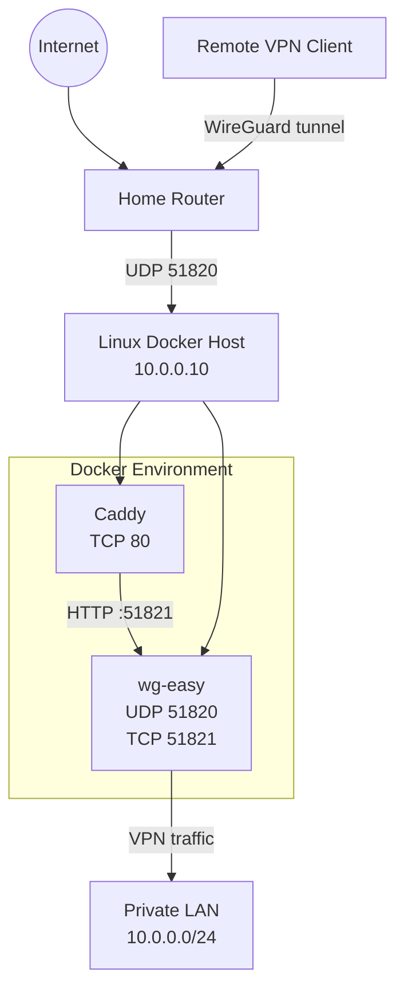

# wireguard-docker

Self-hosted WireGuard VPN server deployed with Docker Compose, using [wg-easy](https://github.com/wg-easy/wg-easy) v15 for VPN and peer management, and [Caddy](https://caddyserver.com/) as a reverse proxy for the web administration interface.

Designed for secure remote access to a private LAN using **split tunneling**. Only traffic destined for explicitly configured networks is routed through the VPN; regular Internet traffic continues to use the client's existing connection.

## Architecture

The deployment consists of two services:

| Service | Purpose |
|---|---|
| `wg-easy` | WireGuard VPN server and web-based peer management. |
| `caddy` | Reverse proxy for the wg-easy administration interface. |

### Network design

- WireGuard listens on UDP port `51820`.
- The administration interface listens internally on TCP port `51821`.
- Caddy exposes the administration interface over HTTP on the host's LAN address.
- The administration interface is not directly published to the Internet.
- Docker bridge networks isolate VPN traffic from the reverse proxy network.
- VPN clients use split tunneling to access the private LAN.

## Architecture



## Requirements

- Linux host with Docker Engine and Docker Compose v2.
- WireGuard kernel module available on the host.
- Publicly reachable IPv4 address (or an equivalent reachable endpoint).
- UDP port `51820` forwarded from the router to the Docker host.
- A static or DHCP-reserved LAN address for the Docker host.

## Quick start

1. Clone the repository:

   ```bash
   git clone <repository-url>
   cd wireguard-docker
   ```

2. Create the environment file:

   ```bash
   cp .env.example .env
   ```

3. Configure the environment variables in `.env`.

4. Ensure the WireGuard kernel module is available:

   ```bash
   sudo modprobe wireguard
   ```

5. Validate the Compose configuration:

   ```bash
   docker compose config --quiet
   ```

6. Start the services:

   ```bash
   docker compose pull
   docker compose up -d
   ```

7. Open the wg-easy administration interface from the LAN:

   ```text
   http://<SERVER_LAN_IP>
   ```

8. Create and configure VPN peers through the wg-easy web interface.

9. Import the generated client configuration into the WireGuard application.

10. Test connectivity to a host on the private LAN.

## Configuration

Configuration is managed through Docker Compose and environment variables.

| Variable | Description |
|---|---|
| `SERVER_LAN_IP` | LAN address of the Docker host. |
| `WG_HOST` | Public IPv4 address or DNS name used by VPN clients. |
| `WG_PORT` | Public WireGuard UDP port. |
| `WG_SUBNET` | Docker network subnet used by the WireGuard container. |
| `PROXY_SUBNET` | Docker network subnet used by Caddy and the administration interface. |

Additional wg-easy settings, including `INSECURE`, `DISABLE_IPV6` and `TRUSTED_PROXIES`, are configured in `compose.yaml`.

Do not commit `.env` or any file containing private keys or credentials.

## Client configuration

Configure client peers through the wg-easy administration interface.

For split tunneling, configure the client's `AllowedIPs` to include only the networks that should be reachable through the VPN.

Example:

```ini
AllowedIPs = 10.0.0.0/24
```

Do not use `0.0.0.0/0` unless full-tunnel routing is explicitly intended.

The WireGuard tunnel subnet can also be included if communication between VPN clients is required.

## Router configuration

Configure a single port forwarding rule:

| Protocol | External port | Internal address | Internal port |
|---|---:|---|---:|
| UDP | 51820 | `<SERVER_LAN_IP>` | 51820 |

Do not forward TCP ports `80`, `443` or `51821` to the Docker host.

The administration interface should remain accessible only from trusted networks.

## Security considerations

- WireGuard encrypts VPN traffic using its own cryptographic protocol.
- The wg-easy administration interface uses HTTP in this deployment and must not be exposed to untrusted networks.
- `INSECURE=true` allows the web interface to operate without HTTPS; it does not disable WireGuard encryption.
- The wg-easy administration interface is reachable through Caddy, not through a directly published host port.
- Keep `.env`, WireGuard private keys, peer configurations and backups out of version control.
- Do not commit client `.conf` files or QR codes.
- Restrict Docker container capabilities to those required for operation.
- Keep Docker images updated and review release notes before upgrading wg-easy.

## Maintenance

Check service status:

```bash
docker compose ps
```

View logs:

```bash
docker compose logs -f wg-easy
docker compose logs -f caddy
```

Inspect WireGuard status:

```bash
docker exec wg-easy wg show
```

Validate configuration:

```bash
docker compose config --quiet
```

Update images:

```bash
docker compose pull
docker compose up -d
```

Back up the persistent `etc_wireguard` Docker volume before performing upgrades or making significant configuration changes.

## Repository structure

```text
wireguard-docker/
├── config/
│   └── Caddyfile
├── scripts/
├── .env
├── .env.example
├── .gitignore
├── compose.yaml
├── LICENSE
└── README.md
```

## License

See [LICENSE](LICENSE).